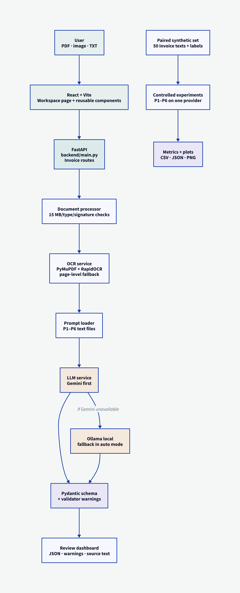
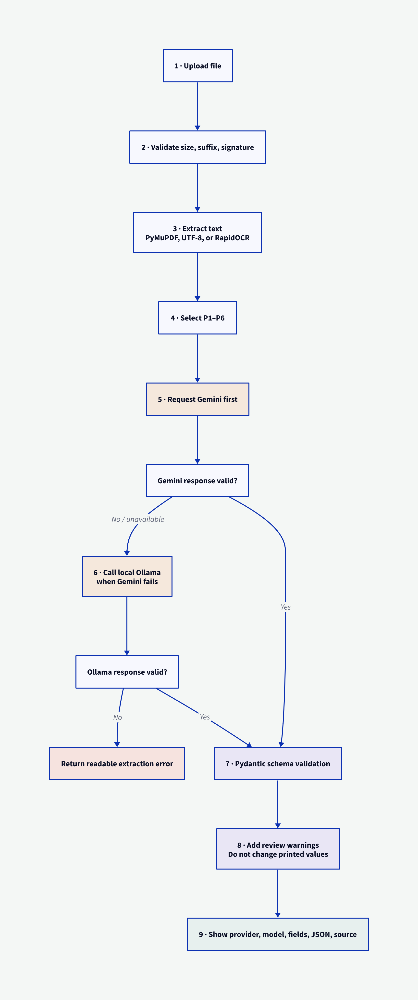

# Documentation

- `architecture.md` explains the module boundaries, research design, limitations, and six-member division.
- `architecture.png` and `workflow.png` visualize the source-defined architecture and request lifecycle.
- `experiment_results/README.md` explains how actual experiment reports are produced. The initial bundle intentionally contains no fabricated metric values.

Use only synthetic, licensed, or authorized documents. Do not commit real customer invoices, API keys, or confidential evaluation examples.

## Diagrams

